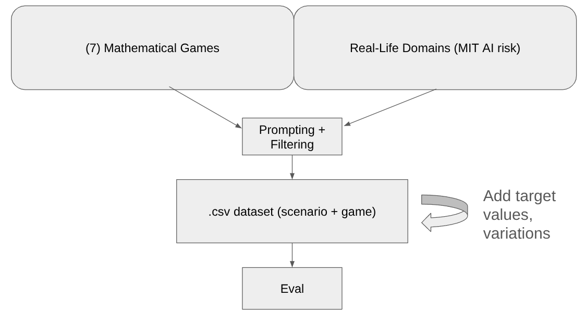

# GT-HarmBench

**Benchmarking AI safety risks through the lens of game theory.**

GT-HarmBench asks a simple question: when a realistic AI-risk situation has the structure of a strategic dilemma, does a language model choose the socially optimal action — or the collectively harmful one?

Each of the **1,535 scenarios** presents a 2×2 symmetric game embedded in a first-person narrative grounded in a real entry from the [MIT AI Risk Repository](https://airisk.mit.edu/). A model is queried twice per scenario — once as the row player, once as the column player — and its choices are scored against four precomputed social-choice targets: **Nash equilibrium**, **utilitarian** (max sum), **Rawlsian** (max-min), and **Nash social welfare** (max product).

Headline results: models fail to choose the socially optimal action in **38%** of scenarios. Adding a game-theoretic mechanism (mediation, contracts, side payments, pre-play communication, penalties) reduces the failure rate by **14–18%**, with mediation performing best.



## The dataset

`data/gt-harmbench-cleaned.csv` — 1,535 scenarios across six canonical 2×2 symmetric games:

| Game | n | | Game | n |
|---|---:|---|---|---:|
| Prisoner's Dilemma | 490 | | Coordination | 180 |
| Chicken | 379 | | Bach or Stravinski | 141 |
| Stag Hunt | 317 | | No Conflict | 28 |

Two properties worth knowing before you use it:

- **Every scenario is grounded.** All 1,535 rows carry a non-null `Ev_ID`, `Domain`, and `Risk category` linking them to a MIT AI Risk Repository entry. There are no un-anchored or synthetic-only scenarios in the release.
- **99.67% structural validity.** An independent verifier (`is_valid_game` in `scripts/generation/fix_contextualizations.py`) mechanically checks each payoff matrix against the canonical ordinal conditions for its game type. 1,530 of 1,535 pass; the 5 failures (4 Bach or Stravinski, 1 Chicken) are genuine ordinal outliers, retained deliberately rather than silently dropped.

See **[DATASET.md](DATASET.md)** for the full datasheet: schema, generation pipeline, domain coverage, human validation, and known limitations.

The dataset ships in this repository — clone it and everything under `data/` is there, no download step. A mirror is also on the Hugging Face Hub at [`causalNLP/gt-harmbench`](https://huggingface.co/datasets/causalNLP/gt-harmbench) if you prefer `datasets.load_dataset`; this repository is the canonical copy.

## Install

Requires Python 3.13 and [uv](https://docs.astral.sh/uv/).

```bash
git clone https://github.com/Flecart/gt-harmbench.git
cd gt-harmbench
uv sync

cp .env.public .env   # then add your API keys
```

`.env` supports `OPENAI_API_KEY`, `OPENROUTER_API_KEY`, and `LITELLM_API_KEY`. All Python commands are prefixed with `uv run`.

## Quick start

Evaluate a model on the benchmark:

```bash
uv run python3 -m eval.eval \
    --model-name openai/gpt-5.1 \
    --dataset data/gt-harmbench-cleaned.csv \
    --times 1 --temperature 1.0 \
    --experiment-name my-eval
```

Start with `--limit 30` for a cheap smoke test. Results are written to `logs/` as `inspect_ai` `.eval` files; browse them with `inspect view --host 0.0.0.0`, then turn them into plots and tables:

```bash
PYTHONPATH=. uv run python -m analysis.cli --plot accuracy --plot welfare --plot heatmap
uv run python3 -m analysis.extract_metrics --directory logs --output metrics_summary.csv
```

## Research questions

The benchmark supports four research questions, each with its own datasets and entry points:

| RQ | Question | Data | Code |
|---|---|---|---|
| **RQ1** | Do LLMs choose collectively harmful actions in high-stakes scenarios? | `gt-harmbench-cleaned.csv` | `eval/eval.py`, `analysis/` |
| **RQ2** | Do order effects and game-theoretic framing drive the results? | `gt-harmbench-gamify.csv`, `gt-harmbench-abstract-full.csv` | `eval/due_diligence.py`, `scripts/experiments/gamify.sh` |
| **RQ3** | Which reasoning patterns explain the results? | reasoning traces from `logs/` | `analysis/reasoning/` |
| **RQ4** | Can mechanisms steer agents toward safer outcomes? | `data/mech_variants/` (20 variants) | `analysis/mechanisms/`, `scripts/experiments/` |

**RQ2 — abstract framing.** `gt-harmbench-abstract-full.csv` strips the narrative entirely, leaving only a payoff matrix with generic "Action A / Action B" labels. It is a **1:1 counterpart to the main dataset** — the same 1,535 scenarios, same ids, same order — so every comparison is exactly paired at the scenario level. Pass `--abstract` to `eval.eval` to swap the system prompt from *"high stakes scenario"* to *"game theory scenario"*; everything else is identical to the standard eval.

**RQ4 — mechanisms.** `data/mech_variants/` holds 20 datasets: five mechanism families (`mediator`, `contracts`, `payments`, `message`, `penalties`) × four framing strengths (`v1_initial`, `v2_formal`, `v3_credibility`, `v4_moral`). Each is the same 1,535 scenarios with mechanism text woven into the narrative.

## Reproducing the paper

**Checking a specific number?** [`PAPER_INDEX.md`](PAPER_INDEX.md) maps every table, figure and headline claim in the paper to the script, data and logs that produce it. The evaluation logs are on [Google Drive](https://drive.google.com/drive/folders/1hyXR_iLqhZiUV8VdqUeI5eMZ6_nA_1iN).

Each experiment is a batch runner in `scripts/experiments/` that writes `.eval` logs to its own directory under `logs/`. Analysis then reads those logs and writes figures and LaTeX tables into `artifacts/`.

| # | Experiment | Runner | Dataset | Logs land in |
|---|---|---|---|---|
| RQ1 | Baseline | `standard.sh` | `gt-harmbench-cleaned.csv` | `logs/standard/` |
| RQ2 | Game-theoretic framing | `gamify.sh` | `gt-harmbench-gamify.csv` | `logs/gamify/` |
| RQ2 | Abstract (no narrative) | `abstract.sh` | `gt-harmbench-abstract-full.csv` | `logs/abstract/` |
| RQ2 | Capability check | `due_diligence.sh` | `gt-harmbench.csv` | `logs/due_diligence/` |
| RQ2 | Coordination variant | `coordination.sh` | `gt-harmbench-coordination-gamify.csv` | `logs/coordination/` |
| — | Cross-play | `cross_play.sh` | `gt-harmbench-cleaned.csv` | `logs/cross_play/` |
| RQ3 | Reasoning traces | `analyze_reasoning.sh` | reads existing logs | — |
| RQ4 | Mechanisms | `mechanisms.sh` | `data/mech_variants/*.csv` | `logs/mechanisms/` |

> **Set your model list first.** Every runner has a `models=(...)` array near the top with most entries commented out, so out of the box it evaluates a single model rather than the full suite. Uncomment the ones you want before launching — a full sweep across all models is a large number of API calls.

A minimal end-to-end pass:

```bash
./scripts/experiments/standard.sh                 # RQ1 baseline  -> logs/standard/
MODEL=openai/gpt-5.1 LIMIT=20 ./scripts/experiments/mechanisms.sh   # RQ4 smoke test

PYTHONPATH=. uv run python -m analysis.cli --plot accuracy --plot welfare --plot heatmap
uv run python3 -m analysis.extract_metrics --directory logs --output metrics_summary.csv
```

`mechanisms.sh` takes an optional filter — `./scripts/experiments/mechanisms.sh mediator` runs only the four mediator variants instead of all twenty.

**Human validation.** `python scripts/validation/compute.py` recomputes both inter-rater agreement figures from the annotator files in `artifacts/validation/`. `scripts/validation/app.py` is the Streamlit annotation tool used to collect them.

### Where things live

```
data/          the benchmark and its variants — canonical, ships with the repo
eval/          evaluation harness; writes .eval logs
analysis/      reads .eval logs, writes figures and tables
game/          pure game-theory helpers (payoffs, Nash)
scripts/
  generation/  the three-stage dataset pipeline
  experiments/ batch runners (the table above)
  analysis/    standalone analysis scripts
  validation/  inter-rater agreement tooling
artifacts/     generated figures, LaTeX tables, validation data
logs/          created on first run; not tracked
```

---

## Detailed usage

### Generating Dataset

The dataset generation process consists of **three steps**:

#### Step 1: Classify AI Risk Scenarios (Filter Game-Theoretic Scenarios)

First, classify which risk scenarios should be modeled as game-theoretic scenarios and which formal games fit each scenario:


```bash
uv run python3 scripts/generation/classify_csv_games.py
```

This script:
- Applies a ruleset to determine if each scenario is game-theoretic (multi-actor strategic interactions, incentive misalignment, coordination problems, etc.)
- For game-theoretic scenarios, assesses fit against all 7 formal games (Prisoner's Dilemma, Chicken, Battle of the Sexes, etc.)
- Outputs `data/mit_game_fit.csv` with boolean flags for each game type

Configuration is in `scripts/generation/config/classify_taxonomy_games.yaml`. Key parameters:
- **taxonomy_path**: location of the taxonomy markdown file
- **template_csv_path**: location of the game templates CSV
- **output_csv_path**: where to write the classification results
- **llm_model**: model for classification
- **use_batch_api**: set to `true` to use OpenAI Batch API (50% cost reduction, but slower)
- **skip_batch_polling**: set to `true` to only submit batch and retrieve later (see below)

**Batch API:** Set `use_batch_api=true skip_batch_polling=true` to submit without waiting; the batch ID is saved to `data/taxonomy_game_fit_batch_id.txt` for later retrieval.

#### Step 2: Generate Contextualizations (Filtered)

Generate contextualized game scenarios only for approved scenarios.

```bash
uv run python3 scripts/generation/generate_contextualizations_from_filter.py
```

This script:
- Reads the classification CSV from Step 1
- Generates contextualizations only for scenarios marked as game-theoretic AND games marked as fitting
- Evaluates each contextualization using a rubric
- Filters by quality and equilibria thresholds
- Outputs `data/contextualization-filtered.csv`

Configuration is in `scripts/generation/config/generate_contextualizations_filtered.yaml`. Key parameters:
- **classification_csv_path**: path to the classification CSV from Step 1
- **llm_model / eval_model**: models for generation and evaluation
- **quality_threshold / equilibria_threshold**: minimum scores to keep (default: 8)
- **use_batch_api**: set to `true` to use OpenAI Batch API


#### Step 2b: Heuristic filter
To remove games in the wrong format:
Run 
```bash
uv run python3 scripts/generation/fix_contextualizations.py
```

#### Step 3: Add Target Data

Add Nash equilibria, utility maximization, and Rawlsian social welfare targets:

```bash
uv run python3 -m scripts.generation.add_targets data/contextualization-filtered.csv data/contextualization-with-targets.csv
```

### Configuration Overrides

All scripts use Hydra for configuration. You can override any parameter at the command line:

```bash
# Override concurrency and enable batch API
uv run python3 scripts/generation/classify_csv_games.py concurrency=10 use_batch_api=true

# Override thresholds
uv run python3 scripts/generation/generate_contextualizations_from_filter.py quality_threshold=7 equilibria_threshold=7

# Dry run to see what would be processed
uv run python3 scripts/generation/generate_contextualizations_from_filter.py dry_run=true
```

### Batch API Mode

For large-scale processing, you can use OpenAI's Batch API which offers:
- **50% cost reduction** compared to standard API calls
- **Automatic retries** and error handling
- **Asynchronous processing** (jobs complete in minutes to hours)

To enable batch mode, set `use_batch_api: true` in your config file or via command line:

```bash
uv run python3 scripts/generation/classify_csv_games.py use_batch_api=true
```

**Note**: Batch API is OpenAI-only (not available via OpenRouter). The scripts will automatically detect and warn if you're using OpenRouter with batch mode enabled.

### Running Experiments

#### Main Evaluation

```bash
uv run python3 -m eval.eval \
    --model-name openai/gpt-5.1 \
    --dataset data/gt-harmbench-cleaned.csv \
    --times 1 \
    --temperature 1.0 \
    --experiment-name gt-harmbench-eval \
    --limit 100
```
Runs game-theoretic strategy evaluations (Nash equilibria, utility maximization, Rawlsian social welfare).

#### Due Diligence Evaluation

```bash
uv run python3 -m eval.due_diligence \
    --model-name openai/gpt-5.1 \
    --dataset-path data/gt-harmbench.csv \
    --task both \
    --reasoning-effort medium \
    --limit -1
```
Evaluates game type recognition (`--task classification`) and/or Nash equilibrium detection (`--task nash`). Use `--task both` for both tasks.

#### Batch Evaluation Scripts

```bash
./scripts/experiments/due_diligence.sh  # Runs due diligence for all models
./scripts/experiments/standard.sh       # Runs main evaluations for multiple models
./scripts/experiments/gamify.sh         # Runs evaluations with gamified dataset
```
Run evaluations across multiple models. Edit the `models` array in each script to customize.

### See results

View results
```bash
inspect view --host 0.0.0.0
# then open: http://localhost:7676
```

## Analysis and Visualization

The analysis CLI recomputes game-theoretic metrics from evaluation logs and generates various plots. It uses a novel parsing approach to extract model actions from responses, ensuring accurate metric computation.

### Basic Usage

```bash
PYTHONPATH=. uv run python -m analysis.cli [OPTIONS]
```

### Available Plot Types

The CLI supports the following plot types:

1. **`accuracy`** - Bar plot showing accuracy metrics (utilitarian, rawlsian, nash) by game type
2. **`welfare`** - Bar plot showing average welfare scores (utilitarian_efficiency, rawlsian_efficiency, nash_social_welfare_efficiency) by game type
3. **`heatmap`** - Heatmaps showing action outcomes (row/column action combinations) by game type
4. **`history`** - Historical trend plot showing model performance over time (release dates on X-axis)
5. **`epoch-accuracy`** - Scatter plot linking Epoch AI benchmark scores with accuracy metrics
6. **`epoch-scores`** - Scatter plot linking Epoch AI benchmark scores with average welfare scores
7. **`due-diligence`** - Bar plot showing due diligence accuracy (classification and Nash equilibrium detection) by model
8. **`math-accuracy`** - ⚠️ **Deprecated** - Use `epoch-accuracy` instead
9. **`math-scores`** - ⚠️ **Deprecated** - Use `epoch-scores` instead

### CLI Options

- `--log-path PATH` - Path to the log file (.eval) or directory to analyze. If not provided, will list available logs and use the first one with samples.
- `--log-type TYPE` - Type of log: `eval` for compressed .eval file, `dir` for directory. Auto-detected if not specified.
- `--max-logs N` - Maximum number of recent logs to list and consider when `--log-path` is not provided (default: 15)
- `--output-dir PATH` - Directory where plots will be saved (default: `assets`)
- `--plot TYPE` - Which plots to generate (can be specified multiple times). Default: `accuracy,welfare,heatmap`
- `--prefix PREFIX` - Prefix to add to output filenames (e.g., `gamify-` will create `gamify-accuracy_by_game_...`). Useful for organizing plots from different experiments.

### Examples

#### Generate default plots for the most recent log

```bash
PYTHONPATH=. uv run python -m analysis.cli
```

This generates:
- `artifacts/baseline/accuracy_by_game_{model_name}.png`
- `artifacts/baseline/welfare_by_game_{model_name}.png`
- `artifacts/baseline/action_{model_name}.png`

#### Generate specific plots for a single model

```bash
# Only accuracy plot (using a specific log file)
PYTHONPATH=. uv run python -m analysis.cli --plot accuracy --log-path logs/2026-01-05T14-45-50+01-00_all-strategies_P9emknPZ4bJq6BBXmpAHuY.eval

# Only welfare plot (using a directory)
PYTHONPATH=. uv run python -m analysis.cli --plot welfare --log-path logs/old-logs --log-type dir

# Only heatmap (auto-detect log type)
PYTHONPATH=. uv run python -m analysis.cli --plot heatmap --log-path logs/some-log.eval

# Multiple plots for a specific log
PYTHONPATH=. uv run python -m analysis.cli --plot accuracy --plot welfare --log-path logs/your-log.eval

# If log-path is not provided, it will list available logs and use the first one
PYTHONPATH=. uv run python -m analysis.cli --plot accuracy
```

> **Note**: For multi-model comparison plots (accuracy heatmaps, action probability grids, LaTeX tables), see the [New Plots CLI](#new-plots-cli-evalplotscli) section below.

#### Generate historical trend plot (all models)

The history plot processes all available logs and doesn't require a specific log index:

```bash
PYTHONPATH=. uv run python -m analysis.cli --plot history
```

This generates:
- `artifacts/summary/historical_trends.png` - Shows efficiency, fairness, and Nash accuracy over model release dates

#### Generate Epoch AI benchmark correlation plots (all models)

These plots process all available logs and link model performance with benchmark scores from Epoch AI:

```bash
# Epoch score vs accuracy metrics
PYTHONPATH=. uv run python -m analysis.cli --plot epoch-accuracy

# Epoch score vs average welfare scores
PYTHONPATH=. uv run python -m analysis.cli --plot epoch-scores

# Both epoch plots
PYTHONPATH=. uv run python -m analysis.cli --plot epoch-accuracy --plot epoch-scores
```

These generate:
- `artifacts/summary/epoch_score_vs_accuracy.png` - Scatter plot with Epoch AI best score (X-axis) vs accuracy metrics (Y-axis)
- `artifacts/summary/epoch_score_vs_avg_scores.png` - Scatter plot with Epoch AI best score (X-axis) vs welfare scores (Y-axis)

**Note**: The Epoch plots use benchmark data from `data/benchmark_data.zip`. The script extracts the "Best score (across scorers)" column from all benchmark CSVs and aggregates scores across benchmarks for each model.

**Deprecated**: The `math-accuracy` and `math-scores` plots are deprecated. Use `epoch-accuracy` and `epoch-scores` instead.

#### Generate due diligence results plot

```bash
PYTHONPATH=. uv run python -m analysis.cli --plot due-diligence
```
Generates `artifacts/summary/due_diligence_results.png` - grouped bar plot showing classification and Nash equilibrium detection accuracy by model.

#### Combine multiple plot types

```bash
# Generate all plots for a single model plus historical trends
PYTHONPATH=. uv run python -m analysis.cli --plot accuracy --plot welfare --plot heatmap --plot history --log-path logs/your-log.eval

# Generate only cross-model comparison plots
PYTHONPATH=. uv run python -m analysis.cli --plot history --plot epoch-accuracy --plot epoch-scores
```

#### Custom output directory

```bash
PYTHONPATH=. uv run python -m analysis.cli --plot accuracy --output-dir results/plots
```

#### Using filename prefix

Add a prefix to all output filenames to organize plots from different experiments:

```bash
# Add "gamify-" prefix to all filenames
PYTHONPATH=. uv run python -m analysis.cli --plot accuracy --plot welfare --prefix gamify

# This will create files like:
# - gamify-accuracy_by_game_{model_name}.png
# - gamify-welfare_by_game_{model_name}.png
# - gamify-action-{model_name}.png
```

### New Plots CLI (eval.plots.cli)

A cleaner CLI for generating plots with an efficient intermediary data format. This is the recommended way to generate multi-model comparison plots.

#### Basic Usage

```bash
uv run python -m eval.plots.cli [OPTIONS]
```

#### Available Plot Types

| Plot Type | Description |
|-----------|-------------|
| `accuracy` | Bar plot showing accuracy metrics by game type (single log) |
| `welfare` | Bar plot showing welfare scores by game type (single log) |
| `heatmap` | Action outcome heatmaps by game type (single log) |
| `accuracy-heatmap` | Accuracy heatmap across models and game types (multi-log) |
| `welfare-heatmap` | Alias for accuracy-heatmap (multi-log) |
| `action-probability-grid` | Grid of 2x2 action probability matrices for each model-game combination (multi-log) |

#### CLI Options

| Option | Description |
|--------|-------------|
| `--log-path PATH` | Path to a single .eval file |
| `--logs-dir PATH` | Directory containing .eval files (default: `logs`) |
| `--max-logs N` | Maximum logs to process (default: 100) |
| `--output-dir PATH` | Output directory (default: `assets`) |
| `--plot TYPE` | Plot type(s) to generate (can be repeated) |
| `--prefix TEXT` | Prefix for output filenames |
| `--multi` | Process all logs for multi-model plots |
| `--latex` | Output LaTeX table instead of PNG (for accuracy-heatmap) |
| `--metric TYPE` | Metric for heatmap: `utilitarian_accuracy`, `nash_accuracy`, `rawlsian_accuracy` |
| `--save-data` | Save intermediary data to CSV/pickle |
| `--load-data` | Load previously saved intermediary data |
| `--list-logs` | List available logs without generating plots |

#### Examples

```bash
# List available logs
uv run python -m eval.plots.cli --list-logs

# Generate default plots for a single log
uv run python -m eval.plots.cli --log-path logs/your-log.eval

# Generate accuracy heatmap across all models
uv run python -m eval.plots.cli --multi --plot accuracy-heatmap

# Generate action probability grid across all models
uv run python -m eval.plots.cli --multi --plot action-probability-grid

# Generate LaTeX table for paper
uv run python -m eval.plots.cli --multi --plot accuracy-heatmap --latex

# Generate multiple plot types
uv run python -m eval.plots.cli --multi --plot accuracy-heatmap --plot action-probability-grid

# Save intermediary data for faster re-runs
uv run python -m eval.plots.cli --multi --plot accuracy-heatmap --save-data

# Load saved data and generate different plots
uv run python -m eval.plots.cli --multi --plot action-probability-grid --load-data
```

### Extract Metrics to CSV

Extract accuracy and average scores from all eval logs in a directory:

```bash
uv run python3 -m analysis.extract_metrics --directory logs --output metrics_summary.csv
```

Processes all `.eval` files in the specified directory and extracts:
- Accuracy metrics: `nash_accuracy`, `utilitarian_accuracy`, `rawlsian_accuracy`, `nash_social_welfare_accuracy`
- Average welfare scores: `utilitarian_efficiency`, `rawlsian_efficiency`, `nash_social_welfare_efficiency`

Outputs a CSV with columns: `log_id`, `model_name`, and all metrics.

**Options:**
- `--directory`, `-d`: Directory containing .eval files (default: `logs`)
- `--output`, `-o`: Output CSV file path (default: `metrics_summary.csv`)

### Compare Metrics Between Experiments

Compare metrics from two CSV files (e.g., gamify vs standard):

```bash
uv run python3 scripts/analysis/plot_metrics_comparison.py
```

Generates `artifacts/summary/metrics_comparison.png` - bar plot comparing Nash Equilibrium and Nash Social Welfare accuracy between two experiments.

**Options:**
- `--gamify-csv`: Path to gamify metrics CSV (default: `results/gamify.csv`)
- `--standard-csv`: Path to standard metrics CSV (default: `results/standard.csv`)
- `--output`: Output image file path (default: `artifacts/summary/metrics_comparison.png`)

The plot shows:
- Blue bars: Nash Equilibrium accuracy (standard baseline)
- Orange bars: Nash Social Welfare accuracy (standard baseline)
- Green/red overlays: Difference between gamify and standard (green = better, red = worse)

### Domain Distribution Analysis

Compute the distribution of MIT AI Risk domains in GT-HarmBench:

```bash
uv run python3 scripts/analysis/domain_distribution.py
```

Joins GT-HarmBench with MIT AI Risk Database on `Ev_ID` and outputs domain counts and percentages.

Analyse model performance (Nash / utilitarian / Rawlsian accuracy) broken down by the 7 risk domains and formal game types for a single eval log:

```bash
uv run python -m scripts.analysis.domain_game_performance --log logs/<name>.eval
```

Outputs three tables: performance by domain, by game type, and a domain × game Nash accuracy pivot. Use `--output results.csv` to save the combined breakdown.

**Options:**
- `--gt-csv`: Path to GT-HarmBench CSV (default: `data/gt-harmbench-cleaned.csv`)
- `--mit-csv`: Path to MIT CSV (default: `data/generation/mit.csv`)
- `--output`, `-o`: Output CSV file path (optional, prints to stdout if not specified)

### Selecting Logs

You can specify a log in two ways:

1. **By path** (recommended): Use `--log-path` to specify the exact log file or directory:
   ```bash
   PYTHONPATH=. uv run python -m analysis.cli --plot accuracy --log-path logs/your-log.eval
   PYTHONPATH=. uv run python -m analysis.cli --plot accuracy --log-path logs/old-logs --log-type dir
   ```

2. **Auto-select**: If `--log-path` is not provided, the CLI will list available logs and automatically use the first one with samples:
   ```
   Available logs (12):
   # Samples Type Model Filename
   --------------------------------------------------------------------------------------------------------------
   0 0 [dir] ? old-logs
   1 2265 [compressed] gpt-4o-2024-08-06 2026-01-06T14-09-54+01-00_gt-experiment-gpt-4o-2024-08-06_cgZhaTpAeSWrMN2mHaPG6L.eval
   ...
   ```

The `--log-type` option can be used to explicitly specify whether the log is a compressed `.eval` file (`eval`) or a directory (`dir`). If not specified, it will be auto-detected based on the path.

**Note**: The `history`, `epoch-accuracy`, `epoch-scores`, and `due-diligence` plots process all logs automatically and don't require `--log-path` (it's ignored for these plot types).

### Output Files

All plots are saved to the specified output directory (default: `artifacts/`):

- **Single-model plots** (require `--log-path` or will auto-select first available), written to `artifacts/baseline/`:
  - `accuracy_by_game_{model_name}.png`
  - `welfare_by_game_{model_name}.png`
  - `action_{model_name}.png`

- **Cross-model plots** (process all logs), written to `artifacts/summary/`:
  - `historical_trends.png`
  - `epoch_score_vs_accuracy.png`
  - `epoch_score_vs_avg_scores.png`
  - `due_diligence_results.png` - Due diligence accuracy by model and task
  - `math_rank_vs_avg_scores.png` (deprecated)

- **Cached data**, written to `artifacts/data/`:
  - `epoch_cache.csv`
  - `leaderboard_cache.csv` (deprecated)

### How It Works

The analysis pipeline:

1. **Loads evaluation logs** from the `logs/` directory (supports both compressed `.eval` files and directories)
2. **Parses model responses** using a novel parsing approach that extracts row and column choices from free-form text
3. **Recomputes metrics** from parsed actions rather than relying on precomputed scores:
   - Accuracy metrics: utilitarian, rawlsian, nash
   - Welfare scores: utilitarian_efficiency, rawlsian_efficiency, nash_social_welfare_efficiency
4. **Generates visualizations** based on selected plot types

The parsing logic handles various response formats and uses edit distance matching as a fallback when exact matches aren't found.

## Repo structure

- **data/** — input datasets (canonical source)
  - `gt-harmbench-cleaned.csv` — **main evaluation dataset** (1,535 scenarios)
  - `gt-harmbench.csv` — same without precomputed targets (used by `due_diligence.py`)
  - `gt-harmbench-gamify.csv`, `gt-harmbench-abstract-full.csv` — RQ2 framing conditions (both 1,535 rows, paired to the main dataset)
  - `mech_variants/` — RQ4 mechanism datasets (5 families × 4 framings)
  - `generation/` — intermediate files from the 3-stage generation pipeline
- **eval/** — evaluation harness (produces `.eval` log files)
  - `eval.py` — main evaluation (RQ1)
  - `due_diligence.py` — game classification + Nash detection (RQ2)
  - `plots/` — newer plotting system with intermediary data format
- **analysis/** — consumes `.eval` log files, produces plots/tables
  - `cli.py` / `core.py` — main analysis CLI
  - `plots/` — plotting library (single-log, multi-log, due-diligence)
  - `reasoning/` — reasoning-trace extraction and classification (RQ3)
  - `mechanisms/` — mechanism design figures (RQ4)
  - `epoch.py` / `leaderboard.py` — external benchmark data helpers
- **game/** — pure game-theoretic math (payoff functions, Nash solvers)
- **scripts/** — invocation scripts only (no core logic)
  - `generation/` — dataset generation pipeline scripts + Hydra configs
  - `experiments/` — batch experiment runners (`standard.sh`, `gamify.sh`, `due_diligence.sh`, `analyze_reasoning.sh`)
  - `analysis/` — standalone analysis scripts (`domain_distribution.py`, `plot_metrics_comparison.py`, etc.)
  - `validation/` — inter-rater agreement Streamlit app
- **artifacts/** — generated outputs
  - `baseline/` — RQ1 standard eval per-model plots + LaTeX tables
  - `gamify/` — RQ2 gamified eval per-model plots
  - `summary/` — aggregate/overview plots (heatmaps, cross-play, pie charts, etc.)
  - `reasoning/` — RQ3 reasoning analysis outputs
  - `mechanisms/` — RQ4 mechanism comparison figures
  - `validation/` — inter-rater agreement outputs
  - `data/` — cached CSVs from analysis runs
  - `pdfs/` — game theory reference PDFs
- **logs/** — outputs from evaluation runs (inspect logs; created on first run, not tracked)
- `pyproject.toml` — project configuration and dependencies
- `.env` — API keys (not in git; copy from `.env.public`)

## Licence

Code is released under the [MIT Licence](LICENSE). Datasets under `data/` are released under [CC BY 4.0](https://creativecommons.org/licenses/by/4.0/), inherited from the [MIT AI Risk Repository](https://airisk.mit.edu/) they derive from. Please retain attribution to both.

## Citation

Pepijn Cobben\*, Xuanqiang Angelo Huang\*, Thao Amelia Pham\*, Isabel Dahlgren\*, Bernhard Schölkopf, Terry Jingchen Zhang†, Zhijing Jin†.

\* Equal contribution.  † Equal supervision.

```bibtex
@article{cobben2026gtharmbench,
  title   = {GT-HarmBench: Benchmarking AI Safety Risks Through the Lens of Game Theory},
  author  = {Cobben, Pepijn and Huang, Xuanqiang Angelo and Pham, Thao Amelia and
             Dahlgren, Isabel and Sch{\"o}lkopf, Bernhard and Zhang, Terry Jingchen and
             Jin, Zhijing},
  journal = {arXiv preprint arXiv:2602.12316},
  year    = {2026},
  url     = {https://arxiv.org/abs/2602.12316}
}
```
